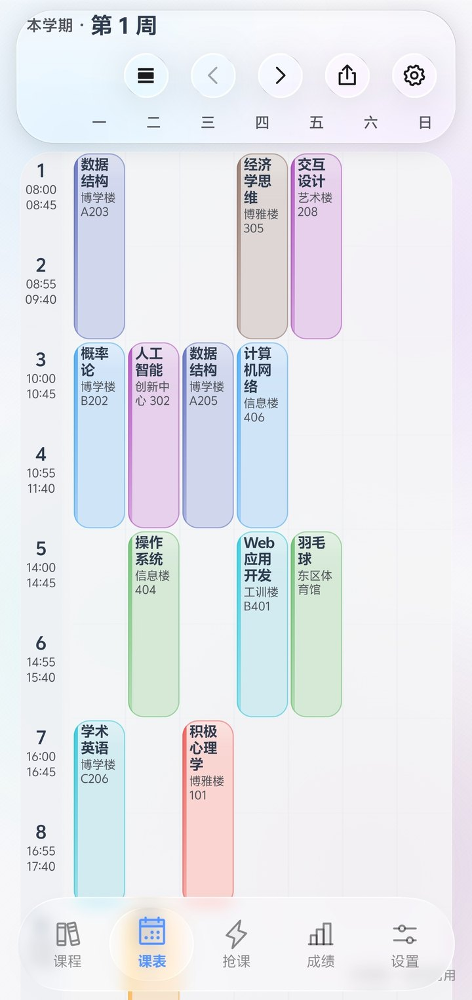
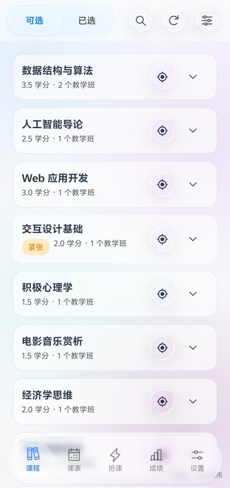
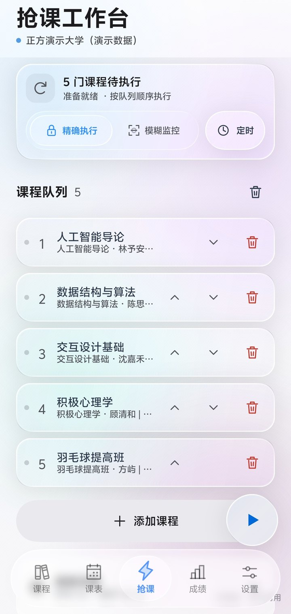
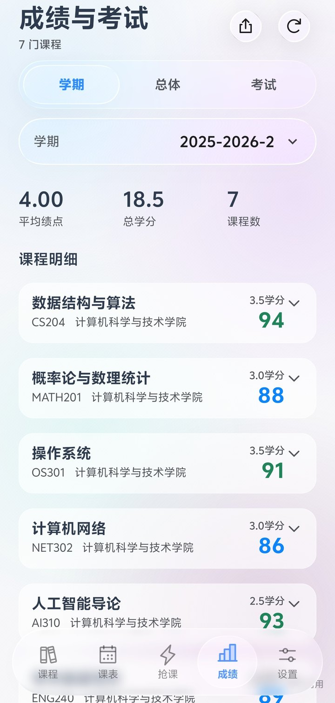
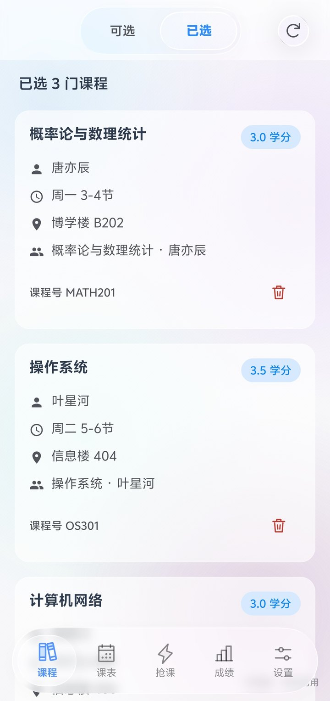
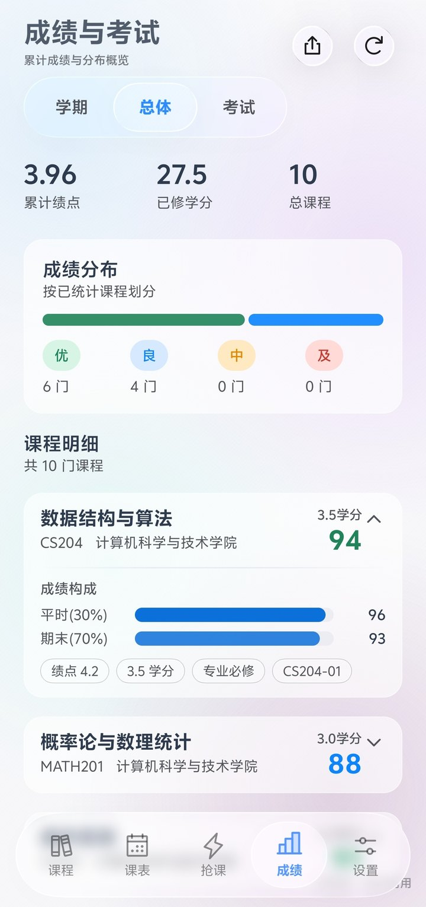
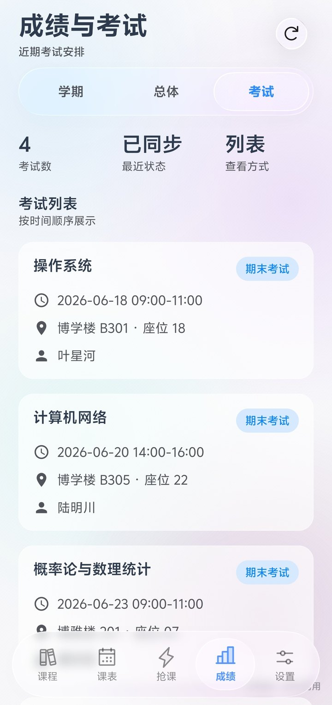
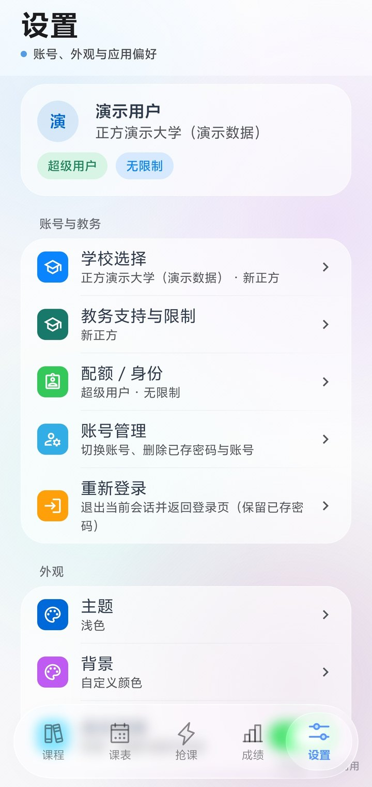
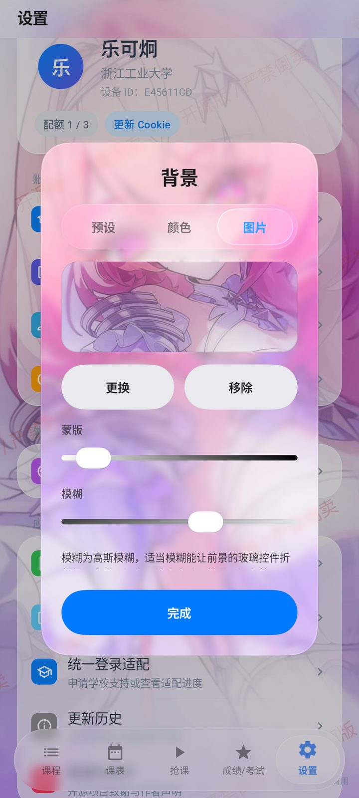
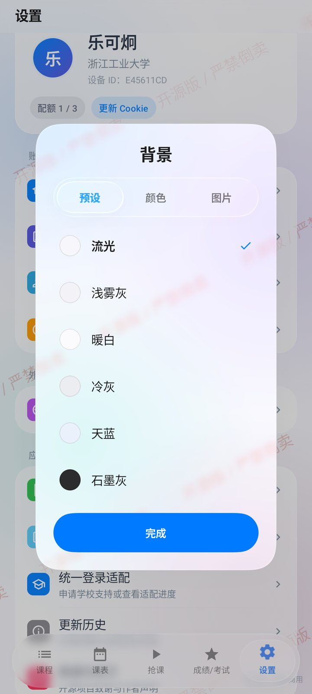

<p align="center">
  
  
  
  
</p>

<h1 align="center">卡皮巴拉教务助手</h1>

> **本项目是 [教务助手](https://github.com/znjhahaha/zhengfang-apk) 的二次开发版本（fork）。**
>
> 原项目由 [@znjhahaha](https://github.com/znjhahaha) 开发，以 GPL-3.0 开源，原始版权归原作者所有。
> 本 fork 沿同一许可发布，具体改动见文末「与原项目的关系」。

<p align="center">
  <strong>开源 · 免费 · 安全</strong><br/>
  Android 教务客户端，支持新正方、旧正方、新强智、旧强智<br/>
  选课、抢课、课表、成绩，UI 是一整套液态玻璃
</p>

<p align="center">
  <a href="LICENSE"></a>
  <a href="https://github.com/znjhahaha/zhengfang-apk"></a>
</p>

---

## 这版有什么

界面全套换成了液态玻璃。折射、色散、高光都是实时算的，按下去会形变，松手弹回来，不是贴一层半透明白糊上去。

- **背景可以自己换**：预设渐变、纯色、或者直接用相册里的图
- **图片背景能调**：模糊和蒙版两根滑条，自己拧到舒服为止
- **配色跟着背景走**：浅色底自动配深字，深色底配浅字，不用手动切
- **顶栏随滚动收起**：往下翻的时候一屏能多看一节多的内容
- **筛选改成浮层**：收起来之后列表不会跳回顶部
- **小屏不再被挡**：16:9 这类短屏幕上，弹窗按钮和列表末项以前会被导航栏压住
- **圆形抢课入口**：玻璃圆钮轻点执行，长按展开带模糊背景的扇形菜单；六个操作沿紧凑的单层圆弧排列，支持滑动选择、松手执行和 SVG 图标反馈
- **图片壁纸顶栏**：修复课表、成绩顶部边缘的白雾和接缝，图片背景保持连贯

老设备跑不动实时模糊会自动回退到透镜采样，不会直接卡死。

---

## 功能

选课抢课：

- 按关键词搜、按类别筛，余量和教师都显示
- 即时执行 — 有空位，拼手速
- 定时任务 — 设好开抢时间，到点自动发包
- 捡漏 — 盯着满员的课，有人退立刻顶上

抢课使用前台服务，定时启动使用 AlarmManager。通知、精确闹钟权限和系统后台限制会影响运行与触发时间；学校仍决定选课窗口、名额、学分和冲突规则。

课表成绩：

- 课表周视图，课程自动配色，可导出 `.ics` 到系统日历
- 成绩按学期查，GPA 自动算，另外还有总体成绩和考试安排

杂项：

- 应用内更新，启动检测新版，下载完直接装
- 公告读本项目自有源（GitHub Pages / Gitee），不经过上游服务；用户反馈通道保持关闭，反馈内容不出本机
- 可添加不同学校，所有版本跨学校合计最多使用 3 个学生账号

---

## 教务系统与限制

当前源码接入以下四类教务。学校地址可自行添加；应用内「设置 → 教务支持与限制」可查看当前学校对应的规则。

| 教务 | 登录 | 执行与数据限制 |
| --- | --- | --- |
| 新正方 | 账密、图片验证码、网页登录；保留原有兼容流程 | 串行或最多 2 门并行；筛选与查询以学校返回内容为准 |
| 旧正方 | 标准 RSA 账密登录、图片验证码获取与刷新 | App 按账号串行保护表单状态；体育课与选退课使用学校当前控件 |
| 新强智 | 直接账密登录；额外的人机验证或统一认证可转网页登录 | App 按账号串行保护轮次上下文；无开放轮次时仍可查询已选、课表和成绩 |
| 旧强智 | 账密登录、图片验证码获取与刷新 | App 按账号串行保护轮次上下文；开放分类及操作权限由学校决定 |

四类教务共用单门/批量选课、退课、队列排序、精确目标、智能匹配和定时任务入口，以及课表、成绩、考试和导出功能。旧正方、新强智、旧强智的筛选使用已加载的学校数据，未公布的容量不会当作有空位。智能匹配限定同一轮次和课程，可更换教师或时段；手动填写的教师与时间仍作为约束。

验证码、选课声明、结果待确认或登录失效时需要人工处理；应用不会绕过学校限制。定制认证、无法识别的操作控件可能仍需网页登录，这属于适配范围，不等同于学校不支持该功能。可在「设置 → 统一登录适配」申请适配。

实网账密登录及查询已验证山东农业大学（新强智）、广州松田职业学院（旧强智）、黑龙江工程学院（旧正方）；原有浙江工业大学统一身份认证流程保留。验证没有向真实学校提交选课或退课。详见[账密验证记录](internal/testing/2026-09-08-password-login-validation.md)及[功能对齐记录](internal/testing/2026-09-08-four-system-parity.md)。

---

## 密码存哪了

支持账号密码登录，学校要求图片验证码时由用户填写；定制登录保留网页登录入口。

密码走 Android KeyStore 的 AES/GCM 加密，仅保存在本机，并在登录时提交到所选学校的教务或认证地址。已保存账密时，App 会在会话过期后尝试续期；学校要求验证码或二次确认时需手动完成。加密或读取失败时按「未保存凭据」处理，不会明文写盘。

不信可以自己翻 `CredentialStore.kt` 和 `SessionRenewer.kt`。

---

## 匿名使用统计

**本应用已关闭匿名统计上报，不采集也不上传任何使用数据。**

上游版本会采集随机安装标识与应用版本并上报到作者自建服务。本 fork 通过
`SelfHostConfig.ENABLE_ANONYMOUS_USAGE_STATS` 关闭了这条通道——开关加在装配层
（`UsageStatsManager` 的 `eligibleBuild`），因此 `UsageReporter` 的通用逻辑与它的
单元测试都保持原样，不会有任何统计请求发出。

---

## 截图

<table>
  <tr>
    <td align="center"><br/><sub>周视图课表</sub></td>
    <td align="center"><br/><sub>课程 · 可选</sub></td>
    <td align="center"><br/><sub>课程 · 已选</sub></td>
    <td align="center"><br/><sub>抢课工作台</sub></td>
  </tr>
  <tr>
    <td align="center"><br/><sub>成绩 · 按学期</sub></td>
    <td align="center"><br/><sub>成绩 · 总体与分布</sub></td>
    <td align="center"><br/><sub>考试安排</sub></td>
    <td align="center"><br/><sub>设置</sub></td>
  </tr>
</table>

实机截图，跑的是内置演示数据（正方演示大学），浅色主题。换背景那一节的图仍是旧版实拍，因为那里要展示的正是壁纸本身。

---

## 快速开始

### 直接下载（推荐）

下载最新 APK：[Gitee 发行版](https://gitee.com/sonder123i/capybara-course-helper/releases)（国内直连快得多）或 [GitHub Releases](https://github.com/sonder123i/capybara-course-helper/releases/latest)，两边是同一个签名包（sha256 一致）。也可以从[官网](https://sonder123i.github.io/capybara-course-helper/)下。装上就能用。Android 7.0+，建议 12 以上，玻璃效果最全。

### 从源码构建

```bash
git clone https://github.com/sonder123i/capybara-course-helper.git
cd capybara-course-helper
./gradlew assembleDebug
```

环境要求：Android Studio Hedgehog+、JDK 17、`compileSdk 37` / `targetSdk 34` / `minSdk 24`。

---

## 新手教程

### 第一步：登录

选择或添加学校，确认新正方、旧正方、新强智、旧强智的类型，再填写教务账号密码。需要验证码时可输入或刷新图片；定制认证按提示打开学校网页。

### 第二步：换背景（可选）

设置 → 背景。预设、颜色、图片三个来源，选图片之后能调模糊和蒙版。

<p align="center">
  
  
</p>

### 第三步：抢课

| 模式 | 啥时候用 | 怎么操作 |
|------|----------|----------|
| 即时执行 | 现在就有空位 | 课程详情 → 立即抢课 |
| 定时任务 | 知道几点开抢 | 先把课加进队列 → 设启动时间 → 到点自动跑 |
| 捡漏 | 想抢已经满了的热门课 | 选好课 → 开捡漏 → 有人退自动顶 |

定时任务得先往队列里加课，队列空着创建不了，会提示你。

### 第四步：看课表 / 查成绩

课表在底栏第二个 Tab，周视图，右上角能导出 `.ics`。成绩在第四个，按学期切，GPA 自动算好。

---

## 技术栈

Kotlin + Jetpack Compose（Material 3）。玻璃渲染用 Kyant Backdrop 2.0，`blur + lens + vibrancy` 三层，按设备能力分档，低端机降级到透镜采样。动效走 Compose Animation，spring/tween 曲线全收在 `MotionTokens` 里。网络 OkHttp + Coroutines，HTML 用 Jsoup 解析。屏幕适配靠 `ScreenMetrics` 的两个连续紧凑度系数插值几何，没有尺寸分档。打包发布走 GitHub Actions。

---

## 二次开发

本 fork 与其上游同样基于 **GPL-3.0** 开源。你可以自由地修改、改名、分发甚至商用，
只需遵守 GPL-3.0 的三条核心义务：

1. 保留原作者的版权声明与本许可
2. 衍生作品继续以 GPL-3.0 发布（不能换成更宽松的许可，也不能闭源）
3. 分发时提供完整对应源码，并显著标注你做了哪些修改

> 上游原作者的表述是「不接受任何形式的私自打包和分发，唯一的二开渠道是向本仓库提 PR」。
> 该表述与 GPL-3.0 第 10 条（不得对所授予的权利附加进一步限制）存在冲突。
> 作为遵循 GPL-3.0 的衍生作品，本 fork 按 GPL-3.0 的条款发布与分发。

提 PR 流程：

1. Fork
2. 改完跑一遍 `./gradlew assembleDebug` 确认能编
3. 提交：`git commit -m 'feat: xxx'`
4. 推上去开 PR

UI 类改动记得附真机截图，审起来省事。

更新日志写在 `release-notes/vX.Y.Z.md`。

---

## 与原项目的关系

本仓库 fork 自 [znjhahaha/zhengfang-apk](https://github.com/znjhahaha/zhengfang-apk)。
原始版权归原作者及其贡献者所有，本 fork 继续以 GPL-3.0 发布（v2 起含 AGPL-3.0 组合组件，见 [LICENSE](LICENSE) 与 [NOTICE](NOTICE)）。

**v2.0.0 起换基线至上游 v1.0.128**：一次性并入上游全部演进（校园插件平台、六类教务协议离线内置、统一认证/WebVPN、课表与提醒增强、签名清单更新等），并在此基础上保持本发行版的独立性：

| 类别 | 内容 |
|---|---|
| 品牌 | 应用名「卡皮巴拉教务助手」；图标与启动页为卡皮巴拉；「关于项目」如实说明二次开发关系 |
| 包名 | `applicationId` 保持 `com.k2767.course`（1.x 用户原位覆盖升级）；源码 `namespace` 恢复 `com.tyust.course`，此后同步上游不再产生全量改名冲突 |
| 服务解耦 | `SelfHostConfig.kt` 集中开关：上游插件目录、地图、油猴代理、反馈、统计、问卷全部切断；插件中心为**仅本地导入模式**（`.zfplugin` / `.eduplugin`），内置六类教务协议包离线可用 |
| 应用更新 | 自建双源（GitHub Pages 主 / Gitee 备）：ECDSA 签名清单 + 断点续传 + 双线路切换 |
| 自有增强 | 惰性会话过期（不主动巡检，减少「正在恢复登录状态」）；账号禁用/锁定等永久失败不自动重试；1.x 的三种 Glance 桌面组件并存续命 |
| 仓库清理 | 移除上游 CI/分发/规格目录；保留自建官网（`docs/`，GitHub Pages）与发布脚本 |

**体积提示**：v2 内嵌浏览器引擎与本地推理组件，安装包约 130MB/架构（1.x 约 5MB），更新按设备架构下发对应包。

## 免责声明

- 项目开源免费，仅供学习交流
- 用出任何后果自己负责
- 抢课归抢课，别挂一晚上把学校教务打挂

## 许可证

[GPL-3.0](LICENSE)
